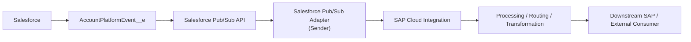
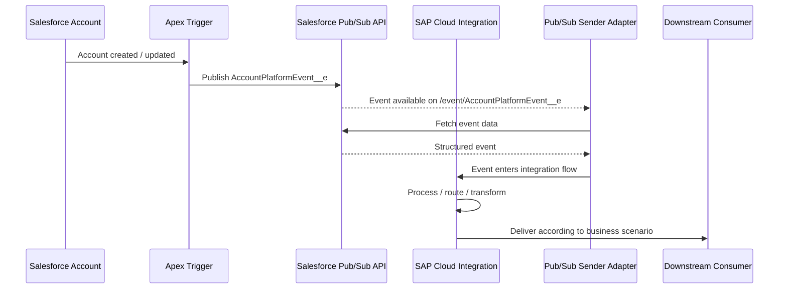

# Salesforce Platform Events Integration

### SAP Integration Architecture Portfolio

The scenario demonstrates how a Salesforce Platform Event can be created and published with Apex and consumed by SAP Integration Suite / SAP Cloud Integration using the **Salesforce Pub/Sub Adapter (Sender)**.

> **Portfolio scope:** This repository documents the mission-supported solution and adds clearly identified architecture recommendations. It does not claim production deployment or a live Salesforce integration beyond the evidence available in the mission.

---

## Executive Summary

The integration follows an event-driven model:

**Salesforce → Salesforce Pub/Sub API → SAP Integration Suite → downstream processing**

A Salesforce `AccountPlatformEvent__e` Platform Event is created for Account data. An Apex trigger publishes the event after Account creation or update. SAP Cloud Integration uses the Salesforce Pub/Sub Adapter Sender to subscribe to the event channel and retrieve event data.

The mission demonstrates:

- Salesforce Platform Event creation
- Apex-based event publication
- Salesforce Pub/Sub API connectivity
- Salesforce Pub/Sub Adapter configuration
- OAuth 2.0 authentication setup
- Event-channel subscription
- Replay-position configuration
- Integration-flow deployment and monitoring

The mission does **not** establish a complete production target-system contract, enterprise alerting model, SLA/RTO/RPO, CI/CD pipeline or full reprocessing architecture. Those items are explicitly separated as portfolio architecture work.

---

## Solution Architecture

### Event flow

---

## Mission vs Portfolio Design

| Area | Mission evidence | Portfolio treatment |
|---|---|---|
| Event source | Salesforce Platform Event | Preserved |
| Event creation | Apex | Preserved |
| Event channel | `/event/AccountPlatformEvent__e` | Preserved |
| Integration platform | SAP Integration Suite / Cloud Integration | Preserved |
| Adapter | Salesforce Pub/Sub Adapter, Sender | Preserved |
| Authentication | OAuth 2.0 options shown in mission | Preserved; exact runtime choice documented |
| Replay | Latest / Earliest / Custom | Preserved |
| Processing | Event retrieved and processed | Preserved |
| Target business system | Not defined by mission | Explicitly left open |
| Production retry/DLQ | Not demonstrated | Recommended separately |
| Enterprise alerting | Not demonstrated | Recommended separately |
| CI/CD | Not demonstrated | Recommended separately |

---

## Architecture Workshops

The project is organized into the same architecture themes used in the existing portfolio:

| Workshop | Main topics | Repository document |
|---|---|---|
| 01. Business Requirements | Business objective, functional scope, event trigger | `business-requirements.md` |
| 02. Solution Architecture | Components, boundaries, event flow | `architecture.md` |
| 03. Integration Pattern | Event-driven architecture, Pub/Sub consumption, replay | `integration-pattern.md` |
| 04. Security | OAuth 2.0, credentials, security material | `security.md` |
| 05. API / Interface Design | Pub/Sub channel, event schema, logical contract | `api-design.md` |
| 06. Mapping | Account → Platform Event payload | `mapping.md` |
| 07. Error Handling | Connection, authentication, event and processing failures | `error-handling.md` |
| 08. Monitoring & Operations | Runtime monitoring, event processing visibility | `monitoring.md` |
| 09. Deployment Strategy | Configuration promotion and deployment boundaries | `deployment-strategy.md` |
| 10. Testing | Functional, integration and negative scenarios | `test-strategy.md` |
| 11. Architecture Decisions | Mediation and event-consumption decisions | `adr-001-event-mediation.md` |
| 12. Limitations / Future Evolution | Mission gaps and next steps | `limitations-future-improvements.md` |
| 13. Mission Evidence | What is directly supported vs recommended | `mission-evidence.md` |

---

## Repository Navigation

- [Business Requirements](docs/business-requirements.md)
- [Solution Architecture](docs/architecture.md)
- [Integration Pattern](docs/integration-pattern.md)
- [Security](docs/security.md)
- [API / Interface Design](docs/api-design.md)
- [Data Mapping](docs/mapping.md)
- [Error Handling](docs/error-handling.md)
- [Monitoring & Operations](docs/monitoring.md)
- [Deployment Strategy](docs/deployment-strategy.md)
- [Test Strategy](docs/test-strategy.md)
- [ADR-001: Event Mediation](docs/adr-001-event-mediation.md)
- [Limitations / Future Improvements](docs/limitations-future-improvements.md)
- [Mission Evidence](docs/mission-evidence.md)

---
