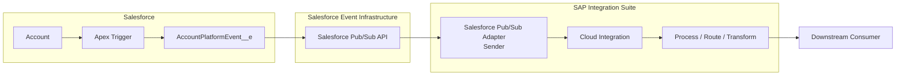

# Solution Architecture

## 1. Architecture overview

The solution is event-driven. Salesforce publishes an Account Platform Event, and SAP Cloud Integration retrieves the event through the Salesforce Pub/Sub API using the Salesforce Pub/Sub Adapter Sender.

## 2. Component responsibilities

| Component | Responsibility |
|---|---|
| Salesforce Account | Business object whose creation/update initiates publication |
| Apex Trigger | Builds Platform Event messages and publishes them |
| `AccountPlatformEvent__e` | Event contract carrying Account information |
| Salesforce Pub/Sub API | Event transport and event-stream access |
| Pub/Sub Adapter Sender | Connects Cloud Integration to Pub/Sub API and fetches events |
| SAP Cloud Integration | Processes and routes retrieved event data |
| Downstream consumer | Business-specific target; not specified by the mission |

## 3. Architectural boundaries

Salesforce remains responsible for event creation and publication. SAP Integration Suite is responsible for consuming and processing the event.

The mission does not define the final downstream business application. Therefore, this repository intentionally does not invent a target system or target API.

## 4. Connectivity

The mission shows the Pub/Sub Adapter connection using:

- Host: `api.pubsub.salesforce.com`
- Port: `7443`
- Salesforce Organization ID as Tenant ID
- Token URL
- Credential references
- OAuth-related security material

Example values visible in the mission screenshots are treated as demonstration/configuration evidence, not reusable credentials.

## 5. Event lifecycle

1. Account is created or updated.
2. Apex trigger creates an event instance.
3. Salesforce publishes the event.
4. Salesforce Pub/Sub API exposes the event on the event channel.
5. SAP Cloud Integration requests event data through the Sender Adapter.
6. The event enters the integration flow.
7. The integration processes it according to downstream requirements.

## 6. Architectural principle

The integration should keep Salesforce-specific connectivity and authentication concerns at the integration boundary while keeping business processing independent from the transport mechanism.
