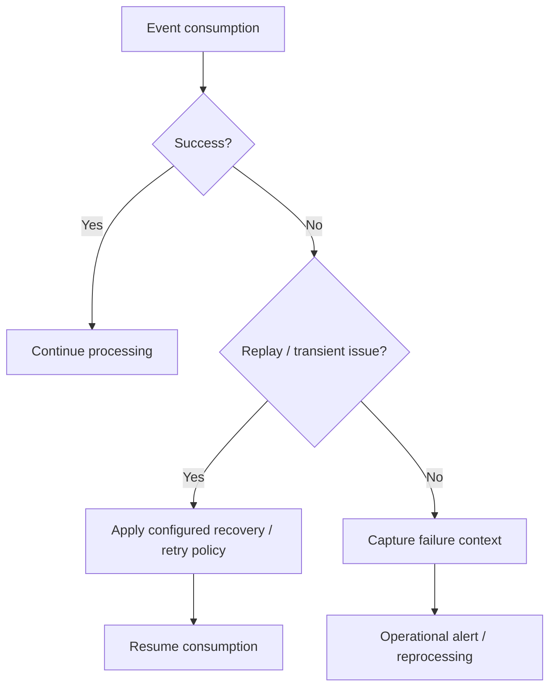

# Error Handling

## 1. Objective

Event-driven integration must distinguish between connectivity problems, authentication failures, replay-position problems and processing failures.

## 2. Handling

The Pub/Sub Adapter configuration includes:

- a replay approach;
- a replay preset for invalid replay IDs;
- a duplicate-check expiration setting;
- an option to process errors as events.

## 3. Error categories

| Category | Example | Recommended action |
|---|---|---|
| Connectivity | Pub/Sub endpoint unavailable | Fail/retry according to platform and integration policy |
| Authentication | Invalid credential/token | Stop consumption and alert support |
| Replay | Invalid/corrupted replay ID | Apply configured replay preset and assess data-loss risk |
| Duplicate | Same event encountered again | Apply idempotent processing |
| Transformation | Event cannot be processed | Capture event context and business error |
| Downstream | Target unavailable/rejects event | Retry where safe; retain failed event for recovery |

The retry, dead-letter and recovery policies are portfolio recommendations, not implementation.

## 4. Recovery model

