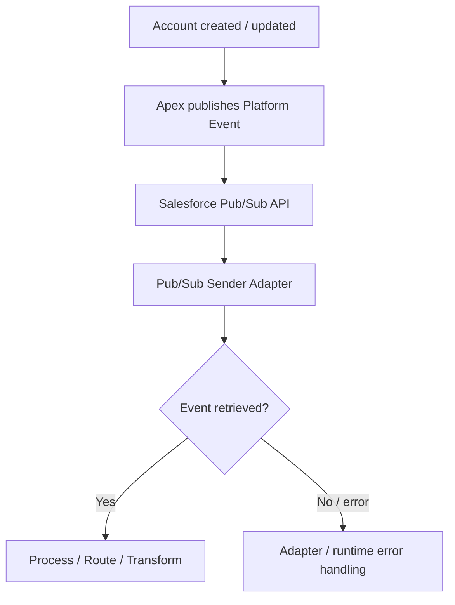

# Integration Pattern

## Pattern: Event-Driven Integration with Pub/Sub Consumption

The mission demonstrates an event-driven pattern in which Salesforce publishes Platform Events and SAP Cloud Integration consumes them through the Salesforce Pub/Sub API.

### Pattern characteristics

- **Trigger:** Salesforce Account create/update
- **Event:** `AccountPlatformEvent__e`
- **Transport:** Salesforce Pub/Sub API
- **Consumer:** Salesforce Pub/Sub Adapter Sender
- **Runtime:** SAP Cloud Integration
- **Processing:** Event retrieval → processing/routing/transformation
- **Direction:** Salesforce → SAP Integration Suite

## Why this pattern fits the use case

A Platform Event avoids requiring SAP Integration Suite to continuously poll the Account object for changes. Salesforce publishes an event when the business object changes, and the integration consumes the event stream.

The mission explicitly describes Platform Events as being available to subscribed consumers in real time.

## Replay model

The adapter provides three replay approaches:

- **Latest** — consume new events from the latest position.
- **Earliest** — consume events from the earliest available position.
- **Custom** — consume from a Salesforce-provided replay position.

The mission uses configuration options for replay handling and specifies a fallback replay preset for an invalid replay ID.

## Processing model

## Architectural extension

For a production implementation, replay strategy should be aligned with the business recovery model. The exact retention, recovery point and downstream idempotency contract are not established by the mission and therefore remain to be defined.
