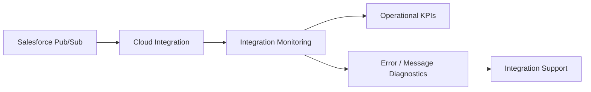

# Monitoring and Operations

## 1. Monitoring objective

Operations should be able to determine:

1. whether the integration flow is deployed;
2. whether event consumption is active;
3. whether messages are being processed successfully;
4. which errors require intervention;
5. whether failed events can be recovered.

## 2. Recommended operational model

## 3. Suggested KPIs

These are portfolio recommendations:

| KPI | Purpose |
|---|---|
| Events received | Consumption volume |
| Events successfully processed | Processing health |
| Processing failures | Error trend |
| Replay/recovery events | Recovery activity |
| Processing latency | Event-to-processing delay |
| Duplicate events | Idempotency health |

No numeric SLA thresholds are defined because the mission does not provide them.

## 4. Logging

Logging should be sufficient to diagnose failures without unnecessarily exposing sensitive event data.

Production logging policy is not specified by the mission.
