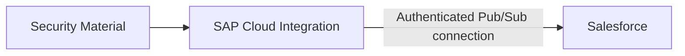

# Security

## 1. Security objectives

The integration must protect:

- Salesforce authentication material;
- Pub/Sub API connectivity;
- event data in transit;
- access to integration artifacts and monitoring.

## 2. Mission-supported security setup

The mission describes security artifacts for Salesforce Pub/Sub connectivity in SAP Integration Suite.

It covers:

- User Credentials
- Secure Parameter for Salesforce Security Token
- OAuth-related credential material
- Token Service URL
- Consumer Key / Consumer Secret

The mission demonstrates both Username-Password and Client Credentials-related setup steps.

## 3. Adapter connection

The Pub/Sub Sender configuration references security artifacts rather than embedding secrets directly in the integration flow.

The demonstrated connection includes:

| Parameter | Role |
|---|---|
| Host | Salesforce Pub/Sub gRPC endpoint |
| Port | Pub/Sub gRPC port |
| Tenant ID | Salesforce Organization ID |
| Authentication | OAuth 2.0 authentication option |
| Token URL | Salesforce authentication endpoint |
| Credential Name | Username/password credential reference |
| Security Token Alias | Secure parameter reference |
| OAuth Credential Name | Consumer key/secret credential reference |

## 4. Security architecture

## 5. Portfolio recommendations

- Keep credentials in SAP Integration Suite Security Material.
- Use separate security artifacts per environment.
- Do not commit secrets, consumer secrets or Salesforce tokens to Git.
- Restrict access to integration artifacts and message logs.
- Review whether event payloads contain sensitive business data before enabling verbose logging.

These recommendations are architecture guidance and are not presented as steps demonstrated by the mission.
